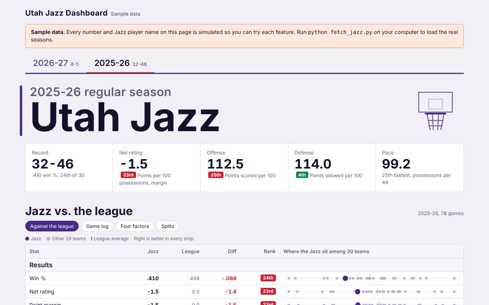
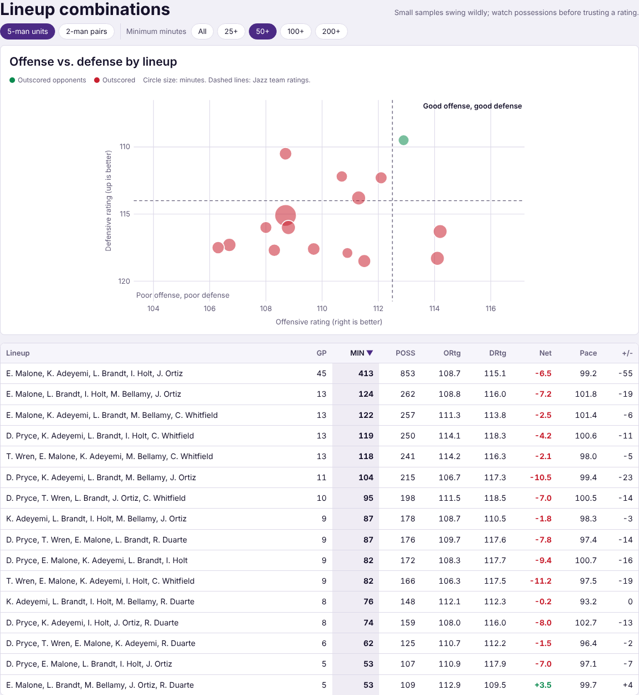

# Utah Jazz Dashboard

A single-page analytics dashboard for the Utah Jazz: team stats against the rest of the league, player stats, lineup combinations, on/off splits, shot charts, and four statistical models. Everything is in one static HTML file with the season data embedded. There is no backend, no build step, and no API key.

**Live:** https://maximhoeft94.github.io/jazz-dashboard/



| Shot chart | Lineups |
|---|---|
|  |  |

*Screenshots show the simulated sample season the repo ships with until `fetch_jazz.py` is run.*

## What it does

- **Season tabs** (current and previous season) that switch every section
- **Jazz vs. the league:** 22 team stats with the league average, the Jazz's rank, and a strip plot showing where they sit among all 30 teams. Also a game-by-game margin chart with a rolling average, Dean Oliver's four factors, and splits (home/road, vs. .500 teams, close games, by month)
- **League table** of all 30 teams (traditional, advanced, four factors), sortable, with a league-average row
- **Players:** per game, per 36, totals, advanced, and shooting views, counting Jazz games only
- **Lineup combinations:** 5-man units and 2-man pairs with a minutes filter, plus an offense-vs-defense scatter
- **On/off court:** Jazz net rating with each player on the floor minus with him off
- **Shot chart:** every Jazz field goal attempt, as hot/cold hexagons compared with the league's FG% from the same zone, or as makes and misses, with a zone table
- **Statistical models**, computed in the browser:
  - Expected wins (Pythagorean, exponent 14) for all 30 teams
  - Shot quality vs. shot making: expected eFG% from shot locations against actual eFG%
  - Lineup impact: a small ridge-regression adjusted plus-minus fitted on the Jazz's 5-man lineups
  - Four-factor model: a regression of net rating on the four factor margins, and where the Jazz gain and lose against an average team
- **Player vs. player radar:** any Jazz player against any Jazz or NBA player, in league percentiles

## How it works

```
stats.nba.com --(fetch_jazz.py)--> JSON embedded in index.html --> vanilla JS + inline SVG
```

- `index.html` is the whole dashboard: HTML, CSS, JavaScript, and the season data. Every chart is hand-built inline SVG.
- `fetch_jazz.py` pulls the seasons and rewrites the data block between the `/*DATA_START*/` and `/*DATA_END*/` markers in `index.html`.
- Finished seasons are cached in `jazz_cache.json`, so a refresh only re-pulls the current season (about 14 requests).

## Stack

- HTML, CSS, and vanilla JavaScript, with no frameworks or chart libraries
- Python 3.9+ standard library only, for the data pull
- GitHub Actions for the daily data refresh, and GitHub Pages for hosting

## Run it

View it: open `index.html` in a browser.

Load real data (the repo ships with simulated sample data until you do):

```
python fetch_jazz.py                       # current + previous season
python fetch_jazz.py --seasons 2026-27     # one season
python fetch_jazz.py --sample              # rebuild the simulated sample
```

**Run the first pull on your own computer.** stats.nba.com often refuses or hangs on requests from cloud servers, including some GitHub Actions runners. The daily workflow (`.github/workflows/refresh-data.yml`) tries anyway; if it times out, the run fails without touching the page, and you can refresh from your machine and push.

## Endpoints

All under `https://stats.nba.com/stats/`: `leaguedashteamstats` (Base, Advanced, Four Factors), `leaguegamelog`, `leaguedashplayerstats` (league-wide and Jazz-only, Base and Advanced), `commonteamroster`, `leaguedashlineups` (5 and 2 players), `teamplayeronoffsummary`, `shotchartdetail`.

## Data

Data comes from the NBA's public, undocumented stats API, which can change without notice. This project is not affiliated with or endorsed by the NBA or the Utah Jazz.

Built by Maxim Hoeft.
