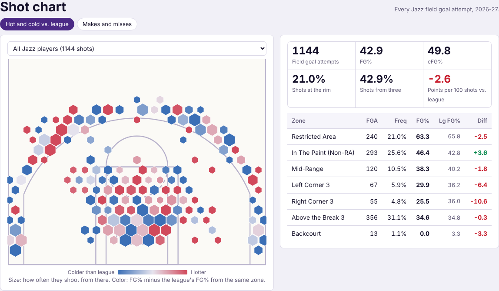

# Utah Jazz Dashboard

A single-page analytics dashboard for the Utah Jazz: team stats against the rest of the league, player stats, lineup combinations, on/off splits, shot charts, and four statistical models. Everything is in one static HTML file with the season data embedded. There is no backend, no build step, and no API key.

**Live:** https://maximhoeft94.github.io/jazz-dashboard/


| Shot chart | Lineups |
|---|---|
|  |  |


## What it does

- **Season tabs** (current and previous season) that switch every section
- **Jazz vs. the league:** 22 team stats with the league average, the Jazz's rank, and a strip plot showing where they sit among all 30 teams. Also a game-by-game margin chart with a rolling average, Dean Oliver's four factors, and splits (home/road, vs. .500 teams, close games, by month)
- **League table** of all 30 teams (traditional, advanced, four factors), sortable, with a league-average row
- **Players:** per game, per 36, totals, advanced, and shooting views, counting Jazz games only
- **Lineup combinations:** 5-man units and 2-man pairs with a minutes filter, plus an offense-vs-defense scatter
- **On/off court:** Jazz net rating with each player on the floor minus with him off
- **Shot chart:** every Jazz field goal attempt, as hot/cold hexagons compared with the league's FG% from the same zone, or as makes and misses, with a zone table
- **Statistical models**, computed in the browser:
  - Expected wins (Pythagorean, exponent 14) for all 30 teams
  - Shot quality vs. shot making: expected eFG% from shot locations against actual eFG%
  - Lineup impact: a small ridge-regression adjusted plus-minus fitted on the Jazz's 5-man lineups
  - Four-factor model: a regression of net rating on the four factor margins, and where the Jazz gain and lose against an average team
- **Player vs. player radar:** any Jazz player against any Jazz or NBA player, in league percentiles

## How it works

```
ESPN box scores + play-by-play --(fetch_jazz.py)--> JSON embedded in index.html --> vanilla JS + inline SVG
```

- `index.html` is the whole dashboard: HTML, CSS, JavaScript, and the season data. Every chart is hand-built inline SVG.
- `fetch_jazz.py` downloads every regular-season game's box score and play-by-play from ESPN's public API and computes everything else:
  - **Team ratings, pace, and four factors** from both teams' box scores, using Basketball-Reference's possession estimate
  - **League player stats and percentiles** from every box score (usage, true shooting, assist and rebound rates, PIE)
  - **Jazz lineups, on/off, and on-court ratings** by following which five Jazz players are on the floor through every substitution. Tracked minutes match the official box score within about a minute, and points match the final score exactly
  - **Shot charts and league zone averages** from every shot's x/y location, sorted into the NBA's shot-chart zones
- Each finished game is reduced to a small record in `games_cache.json` (kept between runs by the workflow), so a refresh only downloads games played since the last one. A finished season's output is saved in `jazz_cache.json`.

## Stack

- HTML, CSS, and vanilla JavaScript, with no frameworks or chart libraries
- Python 3.9+ standard library only, for the data pull
- GitHub Actions for the refresh (every 2 hours, committing only when a game has finished), and GitHub Pages for hosting

## Run it

View it: open `index.html` in a browser, or visit the live link.

Refresh the data: the repo refreshes itself. To refresh right away, open the **Actions** tab, pick **Refresh Jazz data**, and click **Run workflow**. To run it yourself:

```
python fetch_jazz.py                       # current + previous season
python fetch_jazz.py --seasons 2026-27     # one season
```

The first run downloads about 1,400 games (both seasons) and takes 10 to 20 minutes; later runs take under a minute.

## Data

Box scores and play-by-play come from ESPN's public, undocumented API, which can change without notice. NBA.com's own stats API is not used because it refuses requests from GitHub's servers. Advanced numbers are computed here with standard formulas, so they can differ slightly from NBA.com's official figures. This project is not affiliated with or endorsed by the NBA, ESPN, or the Utah Jazz.

Built by Maxim Hoeft.
